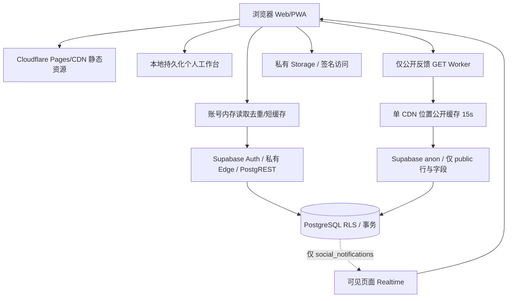

# Cloudflare / Supabase 架构与缓存边界

核查与候选实现：2026-10-16，Web/PWA。Vue SPA、Cloudflare Pages 静态产物、公开反馈 Worker、Supabase Auth/PostgREST/Edge/PostgreSQL/Storage。没有 SSR，不需要为了形式把所有 API 绕经 Worker。

本次优化数据访问层、传输、缓存与生命周期；架构拓扑维持现有职责。浏览器私有请求直达 Supabase 可少一跳、少一次 Worker 配额消耗，也避免第二个权限/凭据处理面。公开只读反馈具备跨用户相同结果，适合现有 Worker 缓存。未新增 KV/D1/R2、多源写入或自建数据库代理。

## 真相与一致性

| 数据 | Source of truth | 可缓存位置 | 写入后行为 |
|---|---|---|---|
| 待办/课程表/个人记录/草稿 | 本地持久化工作区，跨设备通过既有账号快照同步 | 本地和明确的账号恢复副本 | 现有持久化、冲突检测、恢复与 4s 合并继续生效 |
| 校园内容/项目协作/奖励/审核 | Supabase PostgreSQL 与事务规则 | 当前账号内存的有限短缓存 | 既有 mutations 清 cache；旧 in-flight 不可回填 |
| 权限/管理员资格/写入授权 | 每次服务端认证、数据库权限规则 | 不用 CDN 或陈旧快照授权 | 客户端显隐不能替代服务端检查 |
| 公开反馈列表/正文 | Supabase 的 visibility=public 行 | Worker 15s，浏览器进程内短缓存 | 短暂陈旧可接受；私有回复和身份从不进入公开字段 |
| 文件交付 | 私有 Storage 与 object_access | 受授权的浏览器访问 | 保留现有私有策略，不改成公共桶 |

个人工作台本来就是本地优先；没有为了性能把新的服务端私密数据强行搬到 localStorage。内存缓存不是持久共享缓存，切换账号清理；权限、私信、实时状态不使用公开缓存。网络失败必须显示错误，不把失败当空数据成功覆盖。

## 缓存清单

| 对象 | 策略 | TTL/边界 | 失效与安全 |
|---|---|---|---|
| 带 hash 的 JS/CSS/字体/静态图片 | CDN/browser 长缓存 | 1 年 immutable | 文件名 hash；不缓存用户内容 |
| HTML/app shell | no-cache / must-revalidate | 发布检查 | 不让旧 HTML 长期指向删除的分包 |
| sw.js、release.json、version.txt、release history | no-store 或强制复验 | 不长期缓存 | 可靠升级闸门继续保留 |
| Workbox app precache | 离线静态资源 | 整版 manifest | 原全页面离线能力保留；xlsx/OCR/Supabase SDK 按原规则排除 |
| 私有 HTTP 响应 | no-store | 不进 SW runtime/CDN | Authorization/Cookie 不进入公开 cache key |
| 账号读取 cache | 去重 + 有界内存 | 原入口 TTL，每实例默认总载荷 2MiB | 账号范围 key、mutation 清理、清理后旧请求不能回填 |
| 公开反馈 Worker | Cache API | 15s，limit<=60，response<=2MiB | 仅字段白名单，canonical query，按过滤/排序/分页隔离 |
| 公开故障保护 | 状态/截止时间标记 | Worker 最多 30s，浏览器最多 300s | 不保存错误正文或用户信息，401/403 不当作公开缓存 |

公开 Worker 出站只发 publishable/anon apikey，不转发 Authorization/Cookie，不跟随重定向；客户端响应 no-store，内部缓存独立且不含 CORS 用户来源。CORS 允许来源列表且 Vary:Origin。公开可见昵称属于明确发布字段，不等同于真实账号邮箱。Cache API 单位置、可驱逐，无法作为持久存储或全局严格锁。[Cloudflare Cache API](https://developers.cloudflare.com/workers/runtime-apis/cache/)

SWR 只用于允许陈旧的界面读取思路：已有页面先显示保留数据并异步更新。没有将权限判断改为 stale-while-revalidate；到期缓存不能静默延长。新取消机制在消费者全部离开时停止上游，不能让一个组件取消其他组件仍依赖的共享读取。

## 前端、PWA 与地理位置

保留路由级 lazy import；重型 xlsx/OCR/Auth SDK 继续按需加载。将首屏静态可达源码合为 startup-core，把多个路由共享的 composables 依使用关系归并，减少许多微型模块的往返。桌面空闲时只预取一个最常用路由，弱网、省流量、离线或后台不预取；外观与数据工具改为真实使用意图触发加载。没有删除页面、必要动画或换 UI 框架。

只合并分包的早期实验里，移动基础 decoded JS 略有增加，换取较少请求；最终同时移除 main.js 的时段猜测预取，在可见4秒窗口内移动/桌面 JS 总量分别下降36.3%/33.5%，CSS与传输也下降，详见 PERFORMANCE-AUDIT.md。完整离线安装仍下载全站必要静态分包，所以必须分别报告“首屏”和“首次 PWA 安装”，不能只关闭 SW 后宣称总流量已下降。离线重载待办另在正常 SW 上验证。

Supabase 在新加坡；Cloudflare CDN 靠近用户只能改善静态和公开缓存命中，私有 API 的冷启动、跨境链路、Auth 校验及数据库仍需独立测量。本次没有擅自迁移数据库区域。线上 API 服务端 P95 仍高于目标，具体事实见 API-PERFORMANCE.md。

## 安全与可运维性

RLS、原有 service-role 服务端授权、Storage 对象权限、CSP、来源限制、JWT 会话检查均保留。前端环境仅允许 publishable 配置；构建脚本校验公开 key 类型，不把“源码中出现 service_role 拒绝判断文字”误判成泄露，也不输出真实 key。无新增公开 debug/admin endpoint、production source map 或第三方 telemetry 写库。

Realtime 只订阅通知；隐藏/离线移除频道，等待旧频道退出后重连，SUBSCRIBED 后补读，退出清理所有监听器。同步已有 60s 探测、隐藏暂停及错误退避，保留数据一致性。公开 Worker 异常仅记录固定 stage/status/reason，并沿用 1% 平台采样；新增浏览器指标仅进程内保留数值。

旧 sync-coordinator 与测试 Worker 的删除属于线上资源操作，未在缺少依赖证明时执行。无新增单独监控基础设施。Supabase Free 的共享实例、区域链路、暂停和免费配额仍是外部单点边界；本方案不能消除供应商故障或承诺云端无单点。

## 发布顺序与验收边界

迁移 → Supabase 函数 → Web/PWA → 真实账号小流量观察 → 比较同一窗口的 P95/egress/命中/错误，必要时回退应用。只需运行已有部署工具；本轮没有提交、推送、发布或永久迁移。主工作区签名守卫保持有效，隔离副本只为测量构建对齐签名。Windows 原生桌面与小程序没有本轮构建验收。
