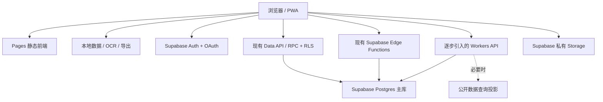

# 前期零支出云架构建议

核对日期：2026-10-15。适用项目：当前工作区的 Web/PWA 版。

用户已明确：不绑定付款方式，不接受扣费风险，目前没有可配置 DNS 的自有域名。本文件记录选型阶段的建议；后续已完成的 Worker、数据库访问权限和附件限制调整见[实施记录](../zero-cost-deployment.md)。免费政策可能变动，开通服务时仍应确认界面没有进入收费订阅。

## 结论与服务选择

建议从 **Cloudflare Pages + Supabase Postgres/Auth/Storage** 起步，保留现有本地优先能力；**Cloudflare Workers** 承接有明确收益的新 API，并逐步替换适合迁移的 Supabase Edge Functions。**D1** 留给确实需要的公共查询索引。当前不启用 R2、Clerk、Resend，不增加 Turso。

这套选择追求的是现有功能、维护投入与免费资源的综合收益。遇到额度不足时，需要限额、暂停部分云功能或继续使用本地模式；不能同时承诺零支出、无限容量和持续在线。

| 层次 | 现在使用 | 使用边界 |
| --- | --- | --- |
| 前端与 PWA | Cloudflare Pages Free | 继续使用已有 `pages.dev` 地址；静态资源直接分发 |
| 业务接口 | 保留已有 Supabase Edge Functions；逐步增加 Workers Free | 优先迁移轻量接口和公共查询；同一请求避免重复经过两套函数 |
| 主数据库 | Supabase Postgres Free | 账号、快照、好友、协作、治理与权限的唯一权威来源 |
| 文件 | Supabase Storage Free | 私有小附件；壁纸、OCR 原图和本地备份默认留在设备 |
| 认证 | Supabase Auth Free | 现有账号继续使用；新增无需自有发信域名的 OAuth 登录 |
| 可选查询库 | D1，暂不创建 | 仅在测量证明必要后，保存可重建的公开数据投影 |
| 暂不引入 | Turso、Clerk、R2、Resend | Turso 当前迁移收益不足；Clerk/Resend 的域名条件、R2 的计费条件不符合本次要求 |

## 项目现状为何影响选择

本次依据实际代码，而非只依据 README：

- `wrangler.jsonc` 已将 Pages 输出目录绑定为 `dist`。
- `src/services/accountSync.js` 直接调用 Supabase Data API 和 `write_account_sync_snapshot` RPC，归属由 JWT 与 RLS 决定。
- `src/composables/accountSyncEngine.js` 已有每 60 秒的版本探测、约 4 秒的修改合并延迟、离线恢复、版本比较及冲突合并。未变化时只取元数据；需要合并时仍拉取完整快照，推送也是完整快照。
- `supabase/migrations/20261006170314_account_sync_snapshots.sql` 使用 `auth.users` 外键、`auth.uid()`、RLS、PL/pgSQL 和 revision 比较写入；单条快照允许最大 16 MiB。
- `supabase/functions/` 已包含社交、协作、校园、管理等接口，依赖 Postgres 查询和 RPC；部分表仅由服务端鉴权后通过特权客户端访问。
- `src/services/projects.js` 已接好私有 `qixing-deliverables` bucket 的上传和短期签名下载链接，单文件上限为 20 MiB。
- 当前邮箱账号流程与部分协作操作依赖邮箱已验证状态；增加 OAuth 必须检查该状态、账号关联和已有用户数据归属。

因此，改用 D1 或 Turso 作为主库，会涉及 SQL 方言、事务、存储过程、用户外键和权限模型的改造。接入 Clerk 也不能直接替换现有 Supabase UUID 与授权关系。现阶段更值得复用现有实现。

## Cloudflare 官方免费额度与限制

| 服务 | 本次核实到的限制 | 对本项目的含义 |
| --- | --- | --- |
| Pages Free | 静态请求免费且不限请求量；500 次构建/月；单资源最大 25 MiB | 适合当前 Vue/Vite/PWA；公开构建资源无需占用附件空间 |
| Workers Free | 100,000 动态请求/日；每次 10 ms CPU | 适合轻量 API；等待网络与 CPU 时间要分开；需测量 JWT、序列化等实际开销 |
| D1 Free | 5,000,000 行读取/日、100,000 行写入/日；账户共 5 GB | 统计的是扫描和写入行数，索引也有写入成本，并非 API 请求数量 |
| D1 单库与单行 | 最多 10 个免费库；每库 500 MB；单行/BLOB/字符串最大 2,000,000 bytes | 5 GB 不是单库容量；不能原样承接允许 16 MiB 的现有快照 |
| R2 Standard 免费用量 | 10 GB-month、每月 100 万次 Class A / 1,000 万次 Class B，直接出站免流量费 | 仍是开通订阅后按量计费的产品，不纳入本次方案 |

来源：[Pages 计费](https://developers.cloudflare.com/pages/functions/pricing/)、[Pages 限制](https://developers.cloudflare.com/pages/platform/limits/)、[Workers 定价](https://developers.cloudflare.com/workers/platform/pricing/)、[D1 定价](https://developers.cloudflare.com/d1/platform/pricing/)、[D1 限制](https://developers.cloudflare.com/d1/platform/limits/)、[R2 定价](https://developers.cloudflare.com/r2/pricing/)。

Pages Functions 与独立 Workers 共享账户的 Workers 请求额度，不能各算 100,000 次/日。静态路由只有在不调用 Functions 时才属于免费静态请求。上线时应检查生成的 Functions 路由配置，避免让全站静态资源穿过动态接口。Workers 超过免费日额度会返回限制错误；D1 达到免费读写额度也会拒绝查询。[Pages 计费](https://developers.cloudflare.com/pages/functions/pricing/)、[Workers 限制](https://developers.cloudflare.com/workers/platform/limits/)、[D1 定价](https://developers.cloudflare.com/d1/platform/pricing/)。

R2 入门流程要求完成订阅 checkout，Cloudflare 购买产品需要付款方式；免费用量之外仍可产生账单。预算提醒只通知，不会暂停或封顶用量。因此不能通过“设置预算提醒”把 R2 变成符合本次要求的无扣费风险产品。[R2 开通](https://developers.cloudflare.com/r2/get-started/)、[付款资料](https://developers.cloudflare.com/billing/get-started/create-billing-profile/)、[预算提醒](https://developers.cloudflare.com/billing/manage/budget-alerts/)。

## Supabase 免费资源如何分配

| 资源 | 当前 Free 额度 | 建议用途 |
| --- | --- | --- |
| Postgres | 500 MB / 项目 | 保留私有快照和需要关系、事务、权限的业务数据 |
| Auth | 50,000 月活用户 | 继续统一 Supabase 身份，不增加第二套用户主身份 |
| Storage | 1 GB | 仅小型私有成果附件，不能当作用户网盘 |
| 普通出站 | 5 GB / 月 | 数据库、Auth、文件、函数、实时等共享，需要统一预算 |
| 缓存出站 | 独立 5 GB / 月 | 不能与普通出站合成可任意使用的 10 GB |
| Edge Functions | 500,000 调用 / 月 | 保留现有接口；按实际瓶颈决定迁移 |
| Realtime | 200 峰值连接、每月 200 万消息 | 暂不为所有打开的页面默认建立实时订阅 |

来源：[Supabase 定价](https://supabase.com/pricing)、[Egress 计量](https://supabase.com/docs/guides/platform/manage-your-usage/egress)。普通 API 数据与个人同步不能假设都能进入缓存出站额度。

免费数据库达到大小限制会进入只读，持续超额可能限制服务；低数据库活动一周后项目可能暂停，免费计划不含自动数据库备份。因此要保留本地模式，并自行备份数据库和附件。[数据库大小](https://supabase.com/docs/guides/platform/database-size)、[免费超额处理](https://supabase.com/docs/guides/platform/billing-faq#what-will-happen-when-i-exceed-the-free-plan-quota)、[暂停规则](https://supabase.com/docs/guides/platform/free-project-pausing)、[备份](https://supabase.com/docs/guides/platform/backups)。

## 无域名时如何处理认证和邮件

保留 Supabase Auth 作为唯一身份来源，优先为内测增加 GitHub OAuth。Google 等提供方可以按受众选择，但应先在真实校园网络测试可达性。OAuth 使用 Supabase 托管的回调地址，并将最终跳转地址配置为现有 Pages 地址，不能将重定向白名单开放为任意 URL。[GitHub 登录配置](https://supabase.com/docs/guides/auth/social-login/auth-github)、[重定向配置](https://supabase.com/docs/guides/auth/redirect-urls)。

这能免除应用自身发送注册验证码邮件的依赖，但用户需要相应提供方账号。对于普通学生，是否愿意使用该登录方式需要验证；若不能接受，只能缩小为本地模式/受控内测，或将可用的邮箱发信资源作为后续条件。

现有邮箱密码用户的登录应保留。未落实正式 SMTP 前，不应把“向任意邮箱注册、验证、找回密码”包装成已经可用的公共服务；也不通过关闭邮箱验证或伪造验证状态绕过现有协作权限。

Supabase 内建 SMTP 仅面向项目团队授权邮箱的测试用途；Resend 的测试发件域名也不能给任意真实用户发信。Clerk 的正式部署另有自有域名要求。[Supabase SMTP](https://supabase.com/docs/guides/auth/auth-smtp)、[Resend 测试域名限制](https://resend.com/docs/knowledge-base/403-error-resend-dev-domain)、[Clerk 正式部署](https://clerk.com/docs/guides/development/deployment/production)。其他厂商当前额度见同目录的 [厂商核对记录](free-tier-vendor-facts-2026-10-15.md)。

站内通知用于协作消息；课表 OCR、搜索、计时等继续在浏览器执行。手机短信与逐次邮件提醒均不作为零预算起步能力。

## 建议的请求和数据流

这是渐进目标，不要求在起步时额外部署一个空转网关。现有可靠同步继续使用 Data API/RPC，避免为每次私有探测额外消耗 Worker 调用。若新增 Worker，使用免费的 `workers.dev` 地址与 Pages 之间配置精确 CORS；不需要先买 API 域名。

Workers 的首批候选是公开校园信息列表、公开检索与发布后的目录等。只缓存审核通过且允许公开的字段；个人快照、好友、项目文件、账号权限和管理数据不进入共享缓存。公共查询缓存必须区分学校、筛选条件、分页和发布版本。先用短 TTL 和版本键管理失效。

缓存命中可以减少 Supabase 回源与出站流量，但进入 Worker 的请求仍占 Worker 请求额度；Worker 从 Supabase 取数据也仍消耗 Supabase 的相应资源。Cache API 缓存在各数据中心独立存在，因此不能把理想命中率当成全局保证。[Workers 定价](https://developers.cloudflare.com/workers/platform/pricing/)、[Cache API](https://developers.cloudflare.com/workers/runtime-apis/cache/)。

## Workers 如何迁移才有收益

1. 将具体函数的业务逻辑与 Deno 入口、环境变量读取、CORS、响应构造分离；Worker 使用自己的 `fetch` 入口与 Secrets。保留现有 Postgres RPC 和事务边界。
2. 校验 Supabase JWT 的签名、签发者、受众与有效期；不能只解码。使用非对称签名时可通过 JWKS 验证，旧 HS256 项目不能直接套用 JWKS，须选择官方支持的验证方式。敏感管理操作还需检查当前用户状态和授权，不只依赖旧令牌。
3. 普通用户数据请求优先传递用户令牌，由现有 RLS 授权。现有 service-role-only 操作保留服务端的成员/角色检查；特权密钥仅保存在服务端。
4. 把函数直接迁成 Worker 到 Postgres/Data API/RPC 的请求，避免 Worker 再调用同一 Supabase Edge Function，使同一次业务操作重复消耗两套函数额度。
5. 逐个接口验证请求/响应、权限拒绝、并发冲突、幂等、CORS 与免费 CPU 限制，再切流量；保留旧接口回退能力。

JWT 依据：[Supabase JWT 验证](https://supabase.com/docs/guides/auth/jwts)。以上是实施建议，本次未验证当前线上签名算法或部署迁移。

## D1 与 Turso 应如何取舍

当前先不增加第二个业务主库。Supabase 已具备项目所需的 Postgres 权限与协作模型；Turso 的免费容量不会自动并入 Supabase，还会增加迁移、鉴权与跨库一致性工作。

如果公共查询量增长，优先考虑 D1：它可直接绑定 Worker，保存已发布校园目录、公开搜索索引或汇总计数。数据库的权威写入仍在 Postgres 完成，在同一事务写入待同步事件，之后按版本、幂等地更新 D1；删除与撤回也必须传播。D1 丢失时可重建。不要把尚未审核内容、成员名单或私人数据当作公共索引复制。

Turso 当前 Free 无需信用卡，提供合计 5 GB、100 个库、每月 5 亿行读取与 1,000 万行写入。容量有吸引力，但不能直接复用本项目的 Postgres 存储过程和 RLS；它的同步流量额度也不是 Supabase 出站预算。[Turso 定价](https://turso.tech/pricing)。

只有在明确需要 Turso 的特定能力，并愿意以它替换某个明确边界的数据域时再评估。不能以“多开一个免费数据库”作为接入理由；D1 的多库容量也不应通过无边界拆分现有事务来获取。

## 真正延长免费期的优先工作

**保留现有同步优化，再降低修改时的整包开销。** 目前元数据探测已避免了“每分钟整包下载”。下一步先测量快照大小、每用户每日 pull 次数、跨设备冲突率和实际出站用量，再判断是否改为分域快照或增量同步。增量方案需要明确删除标记、revision、合并和重放协议，不能只改成“最后写入覆盖”。

以下仅为按字节预算的示例，不是容量承诺，也未计入实际计量、压缩、协议、其他 API、Auth 和附件开销：

| 假设 | 计算 | 含义 |
| --- | --- | --- |
| 500 个账号，平均快照 200 KB | 约 100 MB 快照原始体积 | 数据库还要容纳账号、协作、索引和行版本等开销 |
| 200 个日活账号，每天各下载 5 次 200 KB 快照 | 约 6 GB / 30 天 | 单纯按有效载荷估算已高于 5 GB 普通出站预算 |
| 100 个日活账号，同样的下载模式 | 约 3 GB / 30 天 | 仍必须给其他业务和文件流量留空间 |

数据库空间并非简单等于未压缩 JSON 大小；Postgres 存储方式、索引、其他表和维护状态都会影响实际使用。不能由“50,000 认证用户免费”推导出“50,000 人可免费同步全部业务数据”。

**收紧附件使用方式。** 20 MiB 是现有单文件上限，不适合充当所有用户的默认免费额度。若文件接近这个大小，约 50 个就会接近 1 GB 存储。建议新增上传先设更小的产品限制，例如单文件 5 MB、每账号或项目 20 MB，并在服务端以并发安全方式预留额度、校验真实大小；这些是建议值，不是已实施限制。大文件允许保存外部链接。上传前压缩图片，旧版附件清理需符合用户保留约定。

**保留本地计算。** OCR 原图、壁纸、解析中间结果和用户自行导出的备份继续留在设备；公共固定资源走 Pages。个人课程提醒与计时无需频繁轮询云接口。

**提供提前限额与本地退路。** 以月度出站、数据库空间、附件空间、函数调用等额度的 60% / 80% 设内部提示与降级阈值，且以最先达到的限制为准。接近上限时先限制新上传、降低非关键刷新频率并引导导出；不能宣称一个前端开关可以精确封住所有服务端计量。免费数据库暂停、受限或不可用时，本地基本功能与导出仍应可用。

**做可恢复的备份。** 业务 JSON 导出不等于后台全量备份；数据库 schema、必要业务数据和 Storage 文件应分别备份到维护者本机并验证恢复，不能把用户数据提交 GitHub。Supabase 免费项目的暂停与备份限制见厂商核对记录。

## 建议执行顺序

1. 核对现有项目确为 Free，记录数据库、出站、文件和函数用量；无需升级和绑定支付方式。
2. 小范围增加 OAuth 登录并验证现有账号关联、已验证邮箱规则与协作权限；保留未登录本地模式，暂不开放依赖未就绪邮件服务的注册/恢复入口。
3. 加入快照与附件使用量观测，保留当前元数据探测及冲突协议；从实际最大支出项开始优化。
4. 有明确流量或函数额度收益时，再迁移一组轻量接口到 Workers。免费额度内做一次完整业务流程的 CPU 和请求测量，不能凭架构图判断可承载量。
5. 公共查询证明需要持久化投影时再加 D1。R2、Clerk、Resend 和 Turso 当前均不进入必需依赖。

若将来预算条件改变，先评估能解决实际瓶颈的单项支出。自有域名可解锁正式 Resend 发信；R2 可用于附件增长，但仍需开通按量计费；主库达到限制时再比较付费 Postgres 与真正的数据域迁移。当前不假设这些预算已经获准。
